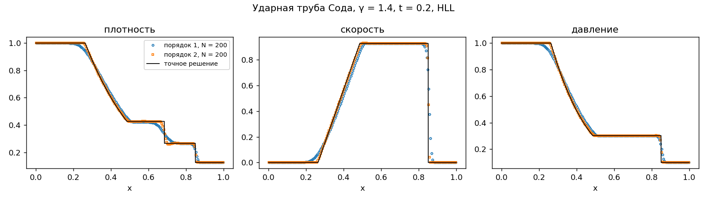
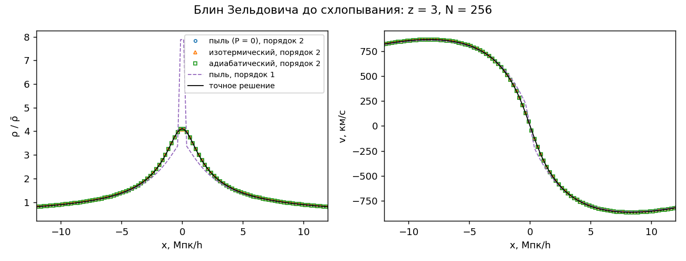
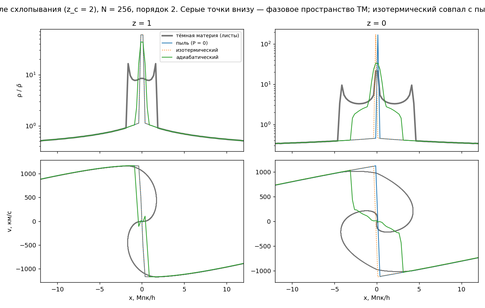
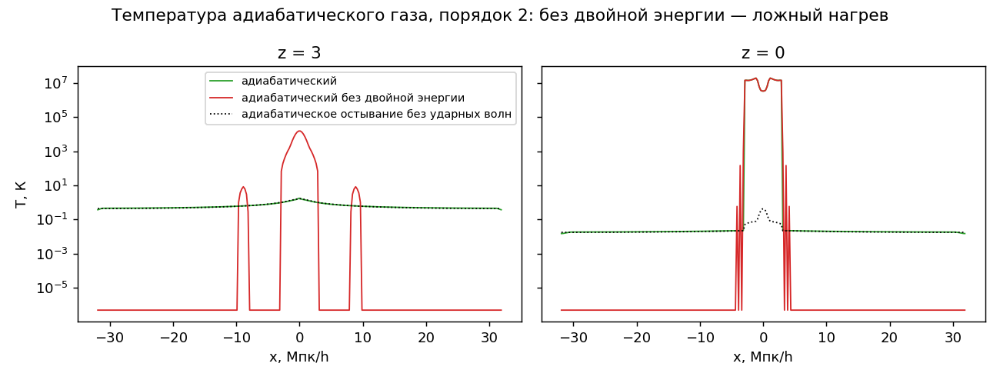
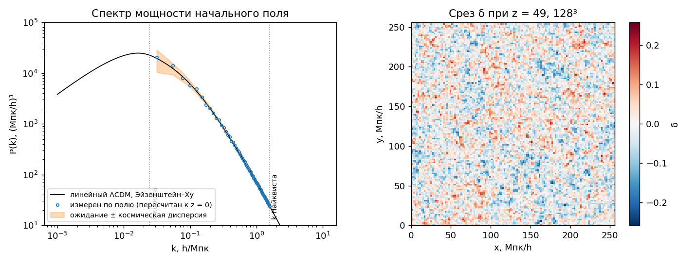
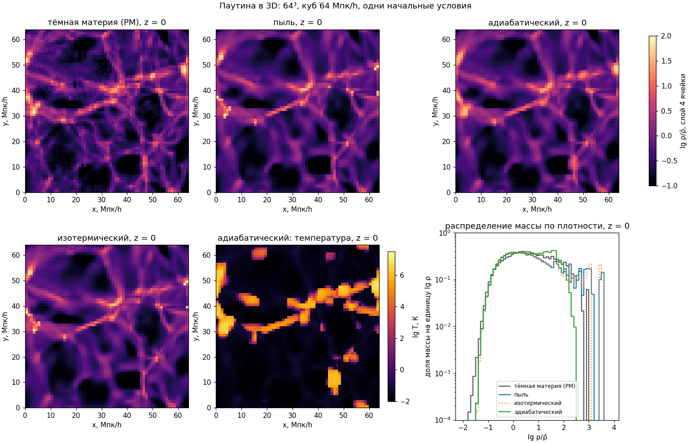
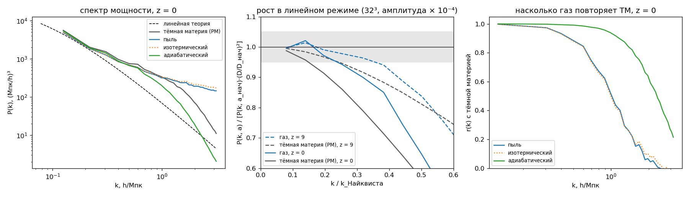

# Прототип: проверка физики и схемы

Прототип Ч1 на Python. Что он делает:

- проверяет схему газа из [equations.md](../equations.md) на задачах с точным решением (1D);
- сравнивает три варианта газа на блине Зельдовича (развилка 2);
- генерирует начальные условия;
- считает ту же схему в 3D и сравнивает газ с тёмной материей из тех же начальных условий;
- содержит скрипты проверок для снимков 3D: масса, рост, спектр, корреляция с тёмной материей.

Ядро на C++ должно повторять отсюда формулы и порядок шага. Результаты прототипа — эталон для сверки.

## Запуск

Нужны numpy, scipy, matplotlib. Все команды — из этой папки.

| Команда | Время | Что делает |
|---|---|---|
| `python3 test_prototype.py` | 1–2 мин | 11 проверок; работает и через `pytest` |
| `python3 shocktube.py` | 8 с | ударные трубы, сходимость, `figures/shocktube_*.png` |
| `python3 zeldovich.py` | 25 с | блин в трёх вариантах и тёмная материя, `figures/pancake_*.png` |
| `python3 ics.py` | 2 с | начальное поле 128³ и проверка его спектра, `figures/ics_power.png` |
| `python3 web3d.py run 64 64` | 15 мин | 3D: сетка 64³, куб 64 Мпк/h, три газа и тёмная материя → `output/web3d_64.npz` |
| `python3 web3d.py plot 64` | 30 с | проверки и графики по сохранённому прогону, `figures/web3d_*_64.png` |

| Файл | Что внутри |
|---|---|
| `cosmology.py` | H(a), a(t), рост D(a) и f(a), перевод энергии в температуру |
| `riemann.py` | точные решения задачи Римана: идеальный и изотермический газ |
| `hydro1d.py` | схема в 1D: HLL, первый порядок и MUSCL + RK2, гравитация через БПФ, расширение, двойная энергия |
| `hydro3d.py` | та же схема в 3D на периодической сетке, без MPI |
| `pm3d.py` | тёмная материя частицами (particle-mesh), начальные смещения по Зельдовичу |
| `checks.py` | проверки снимков: сохранение массы, рост против D(a), корреляция двух полей |
| `shocktube.py` | ударные трубы |
| `zeldovich.py` | блин Зельдовича, точное решение, тёмная материя «листами» |
| `ics.py` | спектр Эйзенштейна–Ху (с осцилляциями и без), гауссово поле, скорости, измерение спектра |
| `web3d.py` | 3D-прогон и его разбор |

---

## Ударная труба

Тест Сода (γ = 1,4) и изотермическая труба (перепад плотности в 10 раз), t = 0,2.

Ошибка плотности L1 против точного решения:

| N | Сод, 1-й порядок | Сод, 2-й | изотерм., 1-й | изотерм., 2-й |
|---|---|---|---|---|
| 100 | 1,9·10⁻² | 4,4·10⁻³ | 1,5·10⁻² | 3,2·10⁻³ |
| 400 | 7,7·10⁻³ | 1,4·10⁻³ | 5,2·10⁻³ | 7,8·10⁻⁴ |
| 1600 | 3,1·10⁻³ | 4,1·10⁻⁴ | 1,7·10⁻³ | 1,7·10⁻⁴ |
| порядок сходимости | 0,63 | 0,87 | 0,76 | 1,00 |

Схема сходится к точному решению. Порядок меньше формального — это норма для решений с разрывами: на ударной волне и контактном разрыве любая схема даёт не выше первого. HLL заметно размазывает контактный разрыв (ступенька на x ≈ 0,7); HLLC держала бы его резче. В космологии контактные разрывы почти не встречаются, поэтому HLL достаточно.

Графики: [Сод](figures/shocktube_sod.png), [изотермическая](figures/shocktube_iso.png), [сходимость](figures/shocktube_convergence.png).

## Блин Зельдовича

Одна синусоидальная волна в кубе 64 Мпк/h, старт при z = 49, схлопывание в плоскость при z = 2, расчёт до z = 0. Космология Quijote. Газ, гравитация и расширение работают вместе.

До схлопывания точное решение известно: формулы в [equations.md](../equations.md#блин-зельдовича-точное-решение), в коде — `Pancake`. После схлопывания точного решения нет. Опорой служит тёмная материя, посчитанная в 1D «листами»: 65 536 частиц, сила в 1D точная — она зависит только от того, сколько массы слева.

### До схлопывания: все три газа совпадают с точным решением

Относительная ошибка L1 плотности при z = 3:

| N | 64 | 128 | 256 | 512 | 1024 |
|---|---|---|---|---|---|
| 1-й порядок | 1,1·10⁻¹ | 9,6·10⁻² | 6,3·10⁻² | 3,6·10⁻² | 1,9·10⁻² |
| 2-й порядок | 2,1·10⁻³ | 1,1·10⁻³ | 3,0·10⁻⁴ | 7,6·10⁻⁵ | 2,8·10⁻⁵ |

Для пыли, изотермического и адиабатического газа цифры одинаковы до второго знака: давление до схлопывания ни на что не влияет. Это ожидаемо, а значит, гравитация, расширение и газ вместе посчитаны верно. Масса сохраняется до 10⁻¹⁶. Листы ТМ совпадают с точным решением до 5·10⁻⁷ Мпк/h — значит, их можно брать опорой после схлопывания.

**Первый порядок даёт ложный пик ×2 в центре** (пунктир на графике): 7,9 вместо 4,1. Это свойство схемы, а не ошибка в коде. Ячейка в точке схождения потока получает вещество через грань со скоростью соседней ячейки, а та в 1,5 раза больше скорости на грани. Плотность в центре растёт как ρ_точная^{1,5}: 4,1^{1,5} ≈ 8,3. В центре пустоты обратный эффект: плотность падает медленнее, чем надо. В 3D узлы паутины — точки схождения сразу по трём осям. Отсюда рекомендация для развилки 3: **второй порядок (MUSCL) сразу**, а не «после работающего 3D». Подробнее в [equations.md](../equations.md#6-схема-по-пространству).

### После схлопывания: газы расходятся

N = 256, второй порядок, z = 0:

| | макс. ρ | средняя ρ в \|x\| < 1 Мпк/h | граница сжатой области | отклонение от ТМ |
|---|---|---|---|---|
| тёмная материя | 21 | 8,8 | 4,3 Мпк/h (крайние каустики) | — |
| пыль | 171 | 21,7 | слой в 1 ячейку | 0,56 |
| изотермический, c = 5,5 км/с | 171 | 21,7 | слой в 1 ячейку | 0,56 |
| адиабатический | 34 | 18,2 | 2,9 Мпк/h (ударная волна) | 0,31 |

«Отклонение от ТМ» — среднее |Δ lg ρ| в центральных ±8 Мпк/h после сглаживания на 1 Мпк/h. 0,56 — типичная разница в 3,6 раза, 0,31 — в 2 раза.

**Изотермический газ совпал с пылью.** Скорость звука выбрана по [project.md](../project.md#6-начальные-условия): длина Джинса при z = 0 — две ячейки, c = 5,5 км/с. Вещество падает в блин со скоростью около 1000 км/с. Давление с такой скоростью звука против этого ничего не может, и вещество собирается в слой толщиной в одну ячейку. Его плотность задаёт сетка, а не физика: при каждом удвоении сетки пиковая плотность растёт вдвое.

| N | 128 | 256 | 512 | 1024 | 2048 |
|---|---|---|---|---|---|
| пыль и изотермический: макс. ρ | 84 | 171 | 341 | 681 | 1361 |
| адиабатический: макс. ρ | 17 | 34 | 48 | 69 | 101 |
| адиабатический: средняя ρ в \|x\| < 1 | 15,3 | 18,2 | 17,7 | 17,9 | 17,9 |
| адиабатический: граница ударной волны, Мпк/h | 2,75 | 2,88 | 2,69 | 2,66 | 2,64 |
| ТМ: макс. ρ | 13 | 21 | 36 | 62 | 96 |

Острый максимум растёт с сеткой у всех, включая ТМ: каустики ТМ и центр адиабатического блина — особые точки. Но у адиабатического газа сходятся ширина сжатой области и плотность в ней, а у пыли — нет.

**Можно ли поднять скорость звука?** Прогон изотермического газа с разной c (N = 256, второй порядок):

| c, км/с | длина Джинса при z = 0, Мпк/h | ошибка до схлопывания | макс. ρ при z = 0 | отклонение от ТМ |
|---|---|---|---|---|
| 5,5 | 0,5 | 3,0·10⁻⁴ | 171 | 0,56 |
| 50 | 4,6 | 7,8·10⁻⁴ | 171 | 0,56 |
| 150 | 13,7 | 6,7·10⁻³ | 85 | 0,54 |
| 300 | 27,3 | 2,5·10⁻² | 20 | 0,42 |

Давление начинает держать блин только при c ≈ 300 км/с. Тогда длина Джинса — 27 Мпк/h, и уже до схлопывания ошибка растёт в 80 раз. В 3D такое давление сотрёт всю структуру мельче 30 Мпк/h, то есть почти всю паутину в кубе 256 Мпк/h. Подходящей скорости звука нет.

**Адиабатический газ нагревается сам.** На ударной волне он нагревается до 10⁷ К, и давление держит сжатую область. Перед волной газ остывает точно по адиабате.

Без двойной энергии температура холодного газа — шум: ложный нагрев до 10³–10⁴ К вокруг блина, а где ошибка ушла в минус — нижний порог (полоса около 10⁻⁶ К). С двойной энергией холодный газ совпадает с адиабатой. Как подобран порог η = 0,01 — в [equations.md](../equations.md#двойная-энергия).

### Рекомендация по развилке 2: какой газ

**Адиабатический с двойной энергией через энтропию, сразу в 3D, без изотермического этапа.**

1. Изотермический газ не даёт ничего сверх пыли. С разумной скоростью звука он после схлопывания неотличим от пыли: всё вещество в слое толщиной в одну ячейку, ответ зависит от сетки. С большой скоростью звука он портит рост до схлопывания.
2. Адиабатический газ ближе к тёмной материи: отклонение 0,31 против 0,56. Ширина сжатой области и плотность в ней сходятся по сетке. Точной ТМ он всё равно не даёт: сжатая область в 1,5 раза уже, центр в 2 раза плотнее. Это оговорка из [project.md](../project.md#5-физическая-модель) — газ не умеет пролетать сам сквозь себя, — теперь с цифрами.
3. Цена — два лишних поля, E и Ŝ: 6 чисел в ячейке вместо 4. Это +50% памяти и обмена гало по газу, плюс около 30 строк двойной энергии, уже отлаженных здесь. Число шагов не растёт: 428 против 424 при N = 256.
4. Пыль (P = 0) остаётся режимом отладки: тот же код с нулевым давлением.

Решать на встрече, вместе с вопросами из [раздела 10 equations.md](../equations.md#10-что-согласовать-с-ч2-и-ч3).

### Находка в 3D: перенос энтропии

Первая 3D-версия брала энтропию на грани из реконструированных P и ρ. При z ≈ 6 из холодной ячейки за шаг вытекло больше энтропии, чем в ней было, давление стало отрицательным, и NaN за несколько шагов разошёлся по всему кубу. В 1D блин этого не показал. Исправление: энтропия переносится потоком массы, удельная энтропия s = Ŝ/ρ берётся с наветренной стороны ([equations.md, раздел 6](../equations.md#6-схема-по-пространству)). 1D-результаты от этого не изменились.

### Находка для порядка шага

Сначала прототип давал ошибку блина, которая падала вдвое при уменьшении шага по времени вдвое и не падала при измельчении сетки. Причина: порядок трения и силы в полукиках. Правильный порядок — в [equations.md, раздел 7](../equations.md#7-шаг-по-времени). После исправления ошибка не зависит от шага (при Δa/a ≤ 1%) и сходится по сетке с порядком 1,6. В C++ это легко повторить, поэтому записано отдельно.

## Начальные условия

Спектр Эйзенштейна–Ху без барионных осцилляций, нормировка на σ8 = 0,834, гауссово поле, скорости растущей моды. Алгоритм — [equations.md, раздел 8](../equations.md#8-начальные-условия).

Для 128³ в кубе 256 Мпк/h при z = 49:

- спектр поля совпадает с заданным: среднее отношение 1,000, разброс 2,4% при космической дисперсии 2,7%;
- σ8 = 0,8340;
- P(k = 0,1 h/Мпк, z = 0) = 6070 (Мпк/h)³ — порядок величины как у Planck/Quijote;
- δ_rms = 0,065, смещения 0,12 ячейки: линейная теория применима, a_нач = 0,02 подходит;
- ∇·v = −aHf·δ до 10⁻¹⁵.

Спектр с барионными осцилляциями — `LinearPower(cosmo, wiggles=True)`, полная формула EH98. Сверка: звуковой горизонт 151 Мпк, расстояние между пиками 0,062 h/Мпк = 2π/101 Мпк/h, амплитуда волны ±5–7%. Для паутины на глаз она не нужна. Для сравнения спектра с Quijote — нужна.

## 3D: паутина, газ против тёмной материи

Та же схема в 3D (`hydro3d.py`): MUSCL + HLL, двойная энергия, Пуассон через БПФ, кики. Тёмная материя — particle-mesh (`pm3d.py`): 128³ частиц, сетка сил 128³, смещения Зельдовича из тех же мод, что у газа. Куб 64 Мпк/h, сетка газа 64³ (ячейка 1 Мпк/h), z = 49 → 0. Прогон — 15 минут на ноутбуке.

Паутина есть во всех вариантах, и волокна стоят на тех же местах, что у тёмной материи. Нагрет ударными волнами только адиабатический газ в волокнах и узлах: горячее 10⁵ К 42% массы, которые занимают 3% объёма.

### Проверки

| Проверка | Результат |
|---|---|
| 3D-код против 1D-кода, блин вдоль x, y и z | совпадают до 4·10⁻¹¹ (тест) |
| Сохранение массы газа | 10⁻¹⁶ на всех выходах |
| Линейный рост, амплитуда × 10⁻⁴, 32³ | первый слой k: газ 0,995, ТМ 0,988 от теории к z = 0 |
| Тёмная материя частицами против точного блина | при сетке сил, равной решётке частиц, отстаёт на 0,2 межчастичного расстояния; при вдвое более мелкой — на 0,03 (в прогоне 0,2 × ½ = 0,1 ячейки газа) |

**Разрешение схемы** (средний график, линейный режим, z = 0):

| k / k_Найквиста | 0,08 | 0,20 | 0,32 | 0,38 | 0,50 |
|---|---|---|---|---|---|
| газ | 0,995 | 0,972 | 0,899 | 0,850 | 0,645 |
| тёмная материя (PM) | 0,988 | 0,914 | 0,789 | 0,714 | 0,565 |

Газ теряет мощность у масштаба сетки: −3% на 0,2 k_Найквиста, −15% на 0,4 k_Найквиста. Спектру можно верить до k ≈ 0,2 k_Найквиста = 0,6/dx. Это вход для выбора параметров финального прогона (неделя 6). Сравнить спектр с Quijote до k = 0,5 h/Мпк с точностью 5% можно при ячейке не крупнее 1,2 Мпк/h: 512³ — куб до 600 Мпк/h, 1024³ — до 1200 Мпк/h. PM теряет больше газа: окно CIC в силе не деконволюировано.

**Рост в полном прогоне.** В первом слое k (0,1 h/Мпк) рост к z = 0 ниже линейного: ТМ 0,86, адиабатический 0,82, пыль 0,74. Во втором слое выше: 1,08–1,18. При z = 9 газ и ТМ отклоняются одинаково (0,97–0,98 и 1,04). Это нелинейность маленького куба, а не ошибка: в линейном режиме тот же код даёт 0,995. В настоящих прогонах куб в 4–8 раз больше.

### Газ против тёмной материи

z = 0, сетка 64³:

| | макс. ρ | масса при ρ > 100 | r(k) с ТМ, k = 0,5 h/Мпк | r(k), k = 1 h/Мпк |
|---|---|---|---|---|
| тёмная материя | 808 | 11% | — | — |
| пыль | 3681 | 18% | 0,885 | 0,51 |
| изотермический | 3699 | 18% | 0,880 | 0,50 |
| адиабатический | 252 | 3% | 0,991 | 0,94 |

r(k) — коэффициент корреляции фурье-мод с тёмной материей. 1 значит, что поле совпадает с ТМ с точностью до множителя на этом масштабе. Сглаживание на r(k) не влияет, на r(k) влияет только то, где лежат структуры.

Это подтверждает рекомендацию по развилке 2 уже в 3D:

- изотермический совпал с пылью и в 3D;
- пыль собирает массу в одиночные ячейки (макс. ρ в 4,5 раза выше, чем у ТМ). Где именно лежат эти пики, на масштабе 1–2 ячеек расходится с ТМ: r = 0,5 на k = 1 h/Мпк;
- адиабатический газ лучше всех повторяет, где лежит вещество (r = 0,94 на k = 1 h/Мпк). Но плотные узлы у него рыхлее, чем у ТМ: выше ρ = 100 только 3% массы против 11%. На видео узлы будут мягче, чем в эталоне из тёмной материи; сравнивать стоит с газовыми кубами CAMELS.

### Для Ч2 и Ч4

- `hydro3d.py` — эталон для 3D-ядра. Одинаковые начальные данные должны давать одинаковые поля до ошибок округления, пока порядок операций тот же.
- `output/web3d_64.npz` — живые кубы 64³ (плотность всех вариантов на z = 9, 3, 1, 0 и температура адиабатического газа). На них можно отлаживать рендер до эталонных кубов. В git не лежит, создаётся командой из раздела «Запуск».
- `checks.py` годится и для снимков C++: функции принимают обычные массивы n³.

## Что дальше

- **Неделя 3, остаток.** Договориться с Ч2 о параметрах первого 3D-прогона ядра: куб, сетка, a_нач. Предложение: 128³ в кубе 128 Мпк/h, z = 49, параметры Quijote, зерно 42 — тогда его можно сверять с прототипом.
- **Неделя 4.** Скрипты проверок готовы (`checks.py`). Осталось подключить их к формату снимков, когда Ч2 его зафиксирует.
- **Неделя 6.** Измерение спектра готово (`ics.measure_power`), разрешение схемы измерено (таблица выше). Параметры финального прогона выбирать от точности, с которой хотим сравнить спектр с Quijote.
- **Можно улучшить**: HLLC вместо HLL (резче контактные разрывы); деконволюция окна CIC в PM, если тёмная материя понадобится точнее.
